# David Wu
### Senior Software Engineer | AI & Blockchain Engineer

Building scalable software, intelligent applications, and decentralized systems.

I am a software engineer focused on designing and building reliable, scalable, and high-performance software solutions. My engineering interests span **Artificial Intelligence, Machine Learning, Blockchain, Distributed Systems, and Full-Stack Development**.

I enjoy solving complex technical challenges, designing robust architectures, and turning ideas into production-ready applications. I believe great engineering combines thoughtful system design, clean code, security, and continuous improvement.

[LinkedIn](https://www.linkedin.com/in/rotsen-merecido-6688a91a5/) · [GitHub](https://github.com/synaptik69) · [Repositories](https://github.com/synaptik69?tab=repositories)

---

## Technical Expertise

**Languages & Backend**
- Python, JavaScript, TypeScript, Rust, Solidity, Node.js
- Express.js, GraphQL, REST APIs

**Frontend Engineering**
- React, Next.js, Tailwind CSS

**Artificial Intelligence & Machine Learning**
- TensorFlow, PyTorch, OpenAI, Hugging Face
- AI-powered applications, machine learning systems, intelligent automation

**Blockchain & Web3**
- Ethereum, Solana, BNB Chain, Polygon, Hyperledger
- Solidity, Web3.js, Ethers.js, Hardhat, Truffle
- Smart Contracts, DeFi, dApps, IPFS, The Graph

**Cloud & Infrastructure**
- AWS, Docker, Kubernetes, Firebase

---

## Selected Projects

### Analyze Solana Wallet
**AI-Powered Blockchain Analytics**

[Website](https://www.aswa-sol.io/)

An AI-powered Solana wallet analytics platform that provides detailed wallet insights, transaction history, on-chain activity analysis, and performance metrics.

### Tradexpro Exchange
**Cryptocurrency Exchange Platform**

[Website](https://tradexpro.org/)

A cryptocurrency exchange platform developed with Laravel, designed to support digital asset exchange and trading functionality.

### Raybot
**Multi-Chain Wallet Monitoring**

[Website](https://www.raybot.app/)

A blockchain monitoring and notification platform that delivers real-time wallet activity alerts across Solana, Tron, Ethereum, Base, BNB Chain, and Polygon.

---

## Engineering Focus

- **System Architecture:** Designing scalable, maintainable, and resilient software systems.
- **Backend Engineering:** Building high-performance APIs, distributed services, and data-driven applications.
- **AI Engineering:** Developing intelligent applications using LLMs, machine learning, and AI-powered automation.
- **Blockchain Engineering:** Building decentralized applications, smart contracts, and Web3 infrastructure.
- **Cloud Infrastructure:** Deploying and operating reliable applications using modern cloud and container technologies.
- **Software Quality:** Applying clean architecture, automated testing, security principles, and engineering best practices.

---

## GitHub Statistics

<picture>
  <source media="(prefers-color-scheme: dark)" srcset="./assets/overview.dark.svg" />
  
</picture>

### Contribution History by Year

<picture>
  <source media="(prefers-color-scheme: dark)" srcset="./assets/lifetime.dark.svg" />
  
</picture>

### Contribution Breakdown

<picture>
  <source media="(prefers-color-scheme: dark)" srcset="./assets/composition.dark.svg" />
  
</picture>

### Contribution Activity

<picture>
  <source media="(prefers-color-scheme: dark)" srcset="./assets/contributions.dark.svg" />
  
</picture>

### Most Used Languages

<picture>
  <source media="(prefers-color-scheme: dark)" srcset="./assets/languages.dark.svg" />
  
</picture>

---

## Let's Connect

I'm always interested in discussing challenging engineering problems, emerging technologies, AI innovation, blockchain development, and open-source collaboration.

- **LinkedIn:** https://www.linkedin.com/in/rotsen-merecido-6688a91a5/
- **GitHub:** https://github.com/synaptik69
- **Repositories:** https://github.com/synaptik69?tab=repositories

---

Building meaningful technology through engineering, innovation, and continuous learning.
